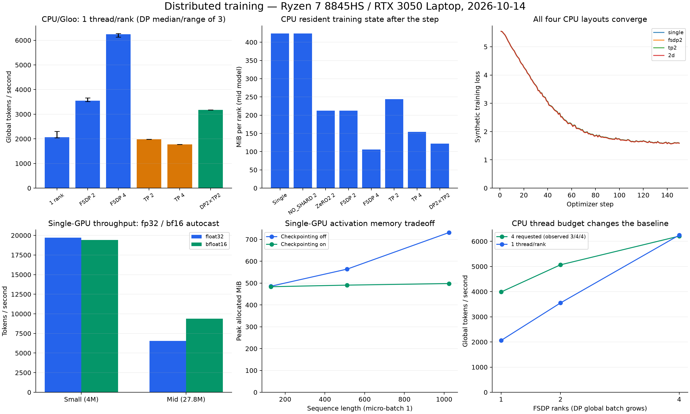
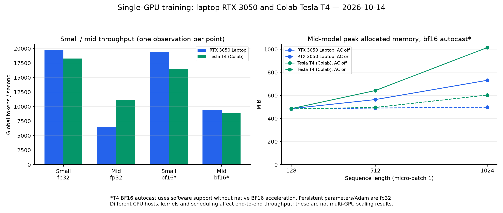

# Full distributed-training benchmark: 2026-10-14

Source commit: `3f96b82778688f27f87f710592b1912103939921`. Training implementation, tests, and shipped configs are unchanged. Benchmark instrumentation adds CUDA measurements, actual-device metadata, isolated result directories, failure accounting, and complete execution records. CPU/Gloo and CUDA/NCCL results below are separate measurements. The user-executed Colab Tesla T4 supplement is reported separately below.

## Findings

The complete correctness suite passes: **97 passed, 1 skipped** in 83.97 seconds. All six CPU scaling layouts, eight memory layouts, collectives at 2 and 4 ranks, both CPU resume layouts, four convergence layouts, and rank-kill recovery complete. The remaining skip is the existing multi-GPU mixed-precision test stub.

The single local RTX 3050 Laptop GPU runs real CUDA training in fp32 and bf16 autocast, including the 151.9M-parameter model shape at reduced batch/sequence settings. Single-GPU checkpoint/resume is bit-exact in both precisions. Multi-GPU NCCL, GPU FSDP/TP/2D, GPU optimizer re-keying, 7B, and multi-node behavior remain unmeasured. Execution failures: none.

## Hardware and isolation

| Item | Observed configuration |
|---|---|
| CPU | AMD Ryzen 7 8845HS; WSL2 exposes 6 logical CPUs / 3 reported physical cores |
| Host/WSL RAM | Windows 16 GiB; WSL 8.7 GiB visible, 4 GiB swap |
| GPU | NVIDIA RTX 3050 Laptop, 4 GiB VRAM; one CUDA device |
| Runtime | Python 3.12.15; PyTorch 2.6.0+cu124; CUDA 12.4; NCCL 2.21.5 |
| CPU cases | CUDA hidden, Gloo over loopback; 1 thread/rank unless explicitly stated |
| CPU budget control | OMP/MKL requests total 4 threads: 1×4, 2×2, 4×1; observed PyTorch totals 3, 4, 4 |
| Resource monitoring | 5-second samples from the memory phase onward; sampled GPU max 56°C; minimum available RAM 4744 MiB |
| NPU | No /dev/accel in WSL; project uses CPU/Gloo or CUDA/NCCL and has no NPU backend |

Each data point runs serially under the benchmark lock. Four CPU ranks share three WSL-reported physical cores, so SMT and scheduling matter. Windows activity and laptop power/thermal limits are not fully isolated. The CUDA-enabled PyTorch build also increases CPU-process runtime footprint relative to the older CPU-only build. [System and dependency snapshot](../benchmarks/results/20261014/system.json).

## Method

All datasets are synthetic. CPU scaling uses the real Trainer/train_step, `small` model (4,000,000 actual parameters), sequence 128, micro-batch 4, accumulation 2, 3 warm-up + 20 timed steps. DP keeps per-rank batch fixed (weak scaling); TP keeps global batch fixed. CPU DP observations repeat three times; within-run step medians are not confidence intervals. The comparison requesting four total threads is a separate single sweep; actual PyTorch counts are recorded.

Memory uses `mid` (27,795,968 actual parameters), sequence 128, micro-batch 1, accumulation 2, 2 warm-up + 4 measured steps. Resident state is parameters + gradients + Adam tensors after the step; RSS also includes Python/PyTorch, allocator caches, and transient full-model construction; summing per-process RSS can double-count shared library pages.

CUDA throughput uses sequence 128, micro-batch 4, accumulation 2, 10 warm-up + 50 timed steps. The memory sweep uses micro-batch 1, accumulation 1, 5 warm-up + 20 timed steps. CUDA timing synchronizes the device; reported tokens/s includes data-window overhead. GPU points are single runs. On one GPU the Trainer uses a bare model: bf16 means autocast with fp32 persistent parameters/Adam, not a GPU FSDP mixed-precision reduction test. MFU is omitted because this GPU has no calibrated peak in the project table. `n_params` in raw records is the config's documented analytical estimate; `actual_n_params` and resident bytes include norm parameters.

## Figures



[Vector figure](../benchmarks/results/20261014/overview.svg).

## CPU throughput and scaling

| run | layout | world | dp | tp | threads/rank | tokens/step | median step (ms) | tokens/s | vs 1 rank | efficiency |
|---|---|---|---|---|---|---|---|---|---|---|
| dp1_pr | single | 1 | 1 | 1 | 1 | 1024 | 458 | 2307 | 1.00x | 100% |
| dp2_pr | FSDP | 2 | 2 | 1 | 1 | 2048 | 548 | 3666 | 1.59x | 79% |
| dp4_pr | FSDP | 4 | 4 | 1 | 1 | 4096 | 645 | 6247 | 2.71x | 68% |
| tp2_pr | TP | 2 | 1 | 2 | 1 | 1024 | 524 | 1984 | 0.86x | 43% |
| tp4_pr | TP | 4 | 1 | 4 | 1 | 1024 | 565 | 1778 | 0.77x | 19% |
| 2d_dp2tp2_pr | 2D | 4 | 2 | 2 | 1 | 2048 | 636 | 3170 | 1.37x | 34% |

The table is the first complete sweep. Its per-rank batch and thread count are fixed; total CPU threads and global DP batch increase with DP degree.

## Three independent CPU DP observations

| Ranks | Tokens/s samples | Median tokens/s | Range |
|---|---|---|---|
| 1 | 2306.9, 2039.3, 2060.4 | 2060.4 | 2039.3–2306.9 |
| 2 | 3666.0, 3522.3, 3551.3 | 3551.3 | 3522.3–3666.0 |
| 4 | 6247.0, 6135.4, 6279.4 | 6247.0 | 6135.4–6279.4 |

Median speedup versus one rank: dp=2 **1.72×**, dp=4 **3.03×**. Dividing by rank count gives 86.2% / 75.8% efficiency for this weak-scaling workload; this is not GPU scaling efficiency.

## CPU thread-budget control

| Ranks | Requested OMP threads/rank | Observed PyTorch threads/rank | Global tokens/step | Tokens/s | Median step ms |
|---|---|---|---|---|---|
| 1 | 4 | 3 | 1024 | 3987.3 | 245.15 |
| 2 | 2 | 2 | 2048 | 5066.7 | 392.91 |
| 4 | 1 | 1 | 4096 | 6206.5 | 650.72 |

OMP/MKL requests total four threads in each run. PyTorch reports 3 threads for the one-rank baseline, 2 per rank for two ranks, and 1 per rank for four ranks: observed totals are 3, 4, and 4. These measurements therefore do not establish equal actual thread counts. Global DP batch still grows with rank count; this does not establish fixed-global-batch strong scaling.

## CPU memory per rank

| run | world | dp | tp | sharding | params MiB/rank | grads MiB/rank | adam MiB/rank | state MiB/rank (mean) | peak RSS MiB (max rank) | peak RSS MiB (sum ranks) |
|---|---|---|---|---|---|---|---|---|---|---|
| mem_single | 1 | 1 | 1 | - | 106.0 | 106.0 | 212.1 | 424.1 | 1188 | 1188 |
| mem_noshard_dp2 | 2 | 2 | 1 | NO_SHARD | 106.0 | 106.0 | 212.1 | 424.1 | 1216 | 2428 |
| mem_zero2_dp2 | 2 | 2 | 1 | SHARD_GRAD_OP | 53.0 | 53.0 | 106.0 | 212.1 | 1210 | 2393 |
| mem_fsdp_dp2 | 2 | 2 | 1 | FULL_SHARD | 53.0 | 53.0 | 106.0 | 212.1 | 1246 | 2487 |
| mem_fsdp_dp4 | 4 | 4 | 1 | FULL_SHARD | 26.5 | 26.5 | 53.0 | 106.0 | 1161 | 4576 |
| mem_tp2 | 2 | 1 | 2 | - | 61.0 | 61.0 | 122.1 | 244.1 | 990 | 1977 |
| mem_tp4 | 4 | 1 | 4 | - | 38.5 | 38.5 | 77.1 | 154.1 | 892 | 3555 |
| mem_2d_dp2tp2 | 4 | 2 | 2 | FULL_SHARD | 30.5 | 30.5 | 61.0 | 122.1 | 970 | 3808 |

Measured state follows sharding: 424.1 MiB unsharded, 212.1 MiB/rank with FULL_SHARD dp=2, 106.0 MiB/rank with dp=4. TP retains replicated embeddings/norms/head, giving 244.1 MiB/rank at tp=2 and 154.1 at tp=4; 2D dp=2,tp=2 gives 122.1 MiB/rank. SHARD_GRAD_OP also has 212.1 MiB/rank at this post-step snapshot: it retains unsharded parameters through forward/backward, then reshards; equal endpoint state does not imply equal transient peaks or gather schedules.

## Measured collective schedule

| World | DP | TP | Layers | Accumulation | FSDP all-gather | FSDP reduce-scatter | c10d all-reduce | Functional TP all-reduce |
|---|---|---|---|---|---|---|---|---|
| 2 | 2 | 1 | 2 | 1 | 5 | 3 | 3 | 0 |
| 2 | 2 | 1 | 2 | 2 | 10 | 3 | 3 | 0 |
| 2 | 1 | 2 | 2 | 1 | 0 | 0 | 16 | 14 |
| 2 | 1 | 2 | 4 | 1 | 0 | 0 | 30 | 28 |
| 4 | 2 | 2 | 2 | 1 | 5 | 3 | 18 | 14 |
| 4 | 2 | 2 | 2 | 2 | 10 | 6 | 32 | 28 |

Counts are rank-0 profiler events for one real train_step after two warm-up steps. In 2D, accumulation deliberately synchronizes each micro-step because the deferred DTensor-gradient path is incompatible with this FSDP1 combination. Operator names/counts remain available in [collectives.jsonl](../benchmarks/results/20261014/collectives.jsonl).

## CPU collective latency and bandwidth

**world size 2**

| op | bytes/rank | median latency (us) | p90 (us) | algbw (MB/s) | busbw (MB/s) |
|---|---|---|---|---|---|
| all_reduce | 1024 | 630.5 | 867.2 | 1.6 | 1.6 |
| all_gather | 1024 | 452.4 | 590.7 | 2.3 | 1.1 |
| reduce_scatter | 1024 | 826.2 | 1027.3 | 1.2 | 0.6 |
| all_reduce | 4096 | 823.9 | 1020.9 | 5.0 | 5.0 |
| all_gather | 4096 | 538.4 | 783.3 | 7.6 | 3.8 |
| reduce_scatter | 4096 | 825.1 | 1152.5 | 5.0 | 2.5 |
| all_reduce | 16384 | 787.5 | 1126.7 | 20.8 | 20.8 |
| all_gather | 16384 | 613.8 | 753.4 | 26.7 | 13.3 |
| reduce_scatter | 16384 | 882.3 | 1171.5 | 18.6 | 9.3 |
| all_reduce | 65536 | 870.1 | 1189.9 | 75.3 | 75.3 |
| all_gather | 65536 | 536.5 | 687.8 | 122.1 | 61.1 |
| reduce_scatter | 65536 | 890.3 | 1209.3 | 73.6 | 36.8 |
| all_reduce | 262144 | 1097.1 | 1517.8 | 238.9 | 238.9 |
| all_gather | 262144 | 598.8 | 815.3 | 437.8 | 218.9 |
| reduce_scatter | 262144 | 986.7 | 1415.6 | 265.7 | 132.8 |
| all_reduce | 1048576 | 1478.7 | 1957.6 | 709.1 | 709.1 |
| all_gather | 1048576 | 1129.4 | 1379.2 | 928.4 | 464.2 |
| reduce_scatter | 1048576 | 1661.1 | 2194.5 | 631.3 | 315.6 |
| all_reduce | 4194304 | 3216.5 | 3543.7 | 1304.0 | 1304.0 |
| all_gather | 4194304 | 2889.2 | 3247.7 | 1451.7 | 725.9 |
| reduce_scatter | 4194304 | 4485.7 | 5129.2 | 935.0 | 467.5 |
| all_reduce | 16777216 | 12513.1 | 13250.4 | 1340.8 | 1340.8 |
| all_gather | 16777216 | 11853.7 | 12670.8 | 1415.4 | 707.7 |
| reduce_scatter | 16777216 | 16799.6 | 18300.7 | 998.7 | 499.3 |

**world size 4**

| op | bytes/rank | median latency (us) | p90 (us) | algbw (MB/s) | busbw (MB/s) |
|---|---|---|---|---|---|
| all_reduce | 1024 | 2362.3 | 6286.5 | 0.4 | 0.7 |
| all_gather | 1024 | 1153.1 | 1451.9 | 0.9 | 0.7 |
| reduce_scatter | 1024 | 2152.6 | 5859.6 | 0.5 | 0.4 |
| all_reduce | 4096 | 2316.1 | 5462.0 | 1.8 | 2.7 |
| all_gather | 4096 | 1275.0 | 1601.4 | 3.2 | 2.4 |
| reduce_scatter | 4096 | 2251.3 | 3421.4 | 1.8 | 1.4 |
| all_reduce | 16384 | 2278.5 | 3784.3 | 7.2 | 10.8 |
| all_gather | 16384 | 1258.9 | 1805.4 | 13.0 | 9.8 |
| reduce_scatter | 16384 | 2204.2 | 3331.6 | 7.4 | 5.6 |
| all_reduce | 65536 | 2303.3 | 4536.1 | 28.5 | 42.7 |
| all_gather | 65536 | 1207.2 | 1610.0 | 54.3 | 40.7 |
| reduce_scatter | 65536 | 2288.2 | 3878.7 | 28.6 | 21.5 |
| all_reduce | 262144 | 2514.1 | 5494.4 | 104.3 | 156.4 |
| all_gather | 262144 | 1426.5 | 2081.9 | 183.8 | 137.8 |
| reduce_scatter | 262144 | 2687.5 | 4614.9 | 97.5 | 73.2 |
| all_reduce | 1048576 | 3031.0 | 3812.1 | 345.9 | 518.9 |
| all_gather | 1048576 | 2120.8 | 2904.2 | 494.4 | 370.8 |
| reduce_scatter | 1048576 | 3427.5 | 3989.6 | 305.9 | 229.4 |
| all_reduce | 4194304 | 6004.4 | 6974.4 | 698.5 | 1047.8 |
| all_gather | 4194304 | 5034.2 | 6237.1 | 833.2 | 624.9 |
| reduce_scatter | 4194304 | 8109.9 | 9775.5 | 517.2 | 387.9 |
| all_reduce | 16777216 | 25637.4 | 28412.4 | 654.4 | 981.6 |
| all_gather | 16777216 | 20026.4 | 21312.4 | 837.8 | 628.3 |
| reduce_scatter | 16777216 | 35580.9 | 42004.9 | 471.5 | 353.6 |

FP32 buffers; 5 warm-up + 30 timed iterations per operator/size. Message bytes denote the full per-rank buffer (all-gather output / reduce-scatter input); bandwidth applies the script's ring correction. These are local-loopback Gloo measurements, not NVLink, PCIe, network, or NCCL link bandwidth.

## CPU checkpoint and resume

| world | dp | params | steps | resumed at | save (s) | build+load (s) | ckpt size (MB, all ranks) | max abs dloss | bit-identical steps |
|---|---|---|---|---|---|---|---|---|---|
| 1 | 1 | 3997696 | 30 | 15 | 0.0362 | 0.1079 | 48.06 | 0.0 | 15/15 |
| 2 | 2 | 3997696 | 30 | 15 | 0.0773 | 0.1858 | 52.31 | 0.0 | 15/15 |

Both jobs compare all 15 post-resume losses against a continuous run; every comparison is bit-identical. The load measurement includes constructing the new Trainer. CPU FSDP uses the raw per-rank optimizer-state fallback and remains topology-locked. Checkpoint durability against power loss is not established by these process-level tests.

## Rank-failure recovery

| world | save every | step at kill | committed ckpts | resumed from | steps lost | detect (s) | relaunch->first step (s) |
|---|---|---|---|---|---|---|---|
| 2 | 10 | 25 | step_10,step_20 | 20 | 5 | 0.47 | 3.73 |

A real worker receives SIGKILL. Torchrun detects the exit in 0.47 seconds; relaunch-to-first-metric takes 3.73 seconds. Recovery selects step 20 after step 25 was reached, losing 5 steps. This is explicit whole-job relaunch, not automatic elastic repair of a running job.

## CPU convergence

| run | world | dp | tp | step 1 | step 25 | step 50 | step 100 | step 150 |
|---|---|---|---|---|---|---|---|---|
| conv_single | 1 | 1 | 1 | 5.546 | 3.969 | 2.656 | 1.741 | 1.592 |
| conv_fsdp2 | 2 | 2 | 1 | 5.546 | 3.964 | 2.644 | 1.734 | 1.586 |
| conv_tp2 | 2 | 1 | 2 | 5.546 | 3.969 | 2.656 | 1.741 | 1.592 |
| conv_2d | 4 | 2 | 2 | 5.546 | 3.964 | 2.644 | 1.734 | 1.586 |

All four layouts use the tiny synthetic workload, global batch 16, 150 steps. The 2D accumulation path now completes, and its loss curve matches the FSDP curve closely; pure TP tracks the single-process curve. These measurements do not establish language-model quality on a real corpus.

## Single-GPU CUDA throughput

Model training runs on the RTX 3050 Laptop through the NCCL/CUDA launch path, world size 1.

| Run | Actual parameters | Autocast policy | Tokens/s | Median step ms | Peak allocated MiB | Peak reserved MiB |
|---|---|---|---|---|---|---|
| cuda_small_float32 | 4000000 | float32 | 19716.6 | 44.46 | 152.9 | 172.0 |
| cuda_mid_float32 | 27795968 | float32 | 6538.0 | 148.59 | 684.1 | 724.0 |
| cuda_small_bfloat16 | 4000000 | bfloat16 | 19404.5 | 45.46 | 138.4 | 164.0 |
| cuda_mid_bfloat16 | 27795968 | bfloat16 | 9368.7 | 101.27 | 672.0 | 708.0 |

The small model is overhead-sensitive: bf16 is not automatically faster. Mid-model bf16 improves throughput in this run. Device peak counters and host process RSS measure different memory. No inter-GPU communication or sharding is exercised at world size 1.

## GPU activation checkpointing

| Sequence | Activation checkpointing | Tokens/s | Peak allocated MiB | Peak reserved MiB |
|---|---|---|---|---|
| 128 | False | 1914.1 | 485.6 | 532.0 |
| 128 | True | 1505.6 | 483.3 | 508.0 |
| 512 | False | 6954.3 | 564.0 | 594.0 |
| 512 | True | 5713.4 | 490.6 | 528.0 |
| 1024 | False | 10713.7 | 731.3 | 782.0 |
| 1024 | True | 9201.4 | 497.8 | 566.0 |

Mid model, bf16 autocast, micro-batch 1, accumulation 1. At sequence 1024 checkpointing lowers the measured allocated peak while reducing throughput; persistent fp32 training state limits savings at short sequences.

## 151.9M-parameter model shape

| Actual parameters | Sequence | Micro-batch | Accumulation | Checkpointing | Tokens/s | Peak allocated MiB |
|---|---|---|---|---|---|---|
| 151898880 | 128 | 1 | 1 | False | 782.8 | 2611.4 |
| 151898880 | 128 | 1 | 1 | True | 476.8 | 2610.2 |

Uses the architecture from config/125m.yaml, whose actual size is 151,898,880 parameters. To fit 4 GiB VRAM, sequence is reduced from 1024 to 128, micro-batch from 16 to 1, and accumulation from 4 to 1; data workers are 0. It is a 3-warm-up + 10-step computational measurement, not the shipped full-size workload or a completed pretraining run. The 7B config is not attempted on this hardware.

## Single-GPU checkpoint and resume

| Autocast policy | Save seconds | Build+load seconds | Checkpoint MB | Max loss difference | Identical steps |
|---|---|---|---|---|---|
| float32 | 0.1073 | 0.1938 | 48.06 | 0.0 | 15/15 |
| bfloat16 | 0.0681 | 0.1664 | 48.06 | 0.0 | 15/15 |

Small model, world size 1, 30 steps with resume at 15. Both policies retain fp32 persistent model/optimizer state. This validates the unsharded CUDA path; GPU FSDP optimizer re-keying requires a multi-GPU host and remains untested.

## Profiler traces

| Backend | Ranks | Profiled steps | Attributed device/CPU microseconds | Collective fraction |
|---|---|---|---|---|
| gloo | 2 | 3 | 1929271.6 | 0.0028 |
| nccl | 1 | 3 | unavailable | unavailable |

[CPU trace](../benchmarks/results/20261014/profile-gloo.json.gz), [CPU operator summary](../benchmarks/results/20261014/profile-gloo.txt), [CUDA trace](../benchmarks/results/20261014/profile-nccl.json.gz), [CUDA operator summary](../benchmarks/results/20261014/profile-nccl.txt). Gloo breakdown uses CPU self-time. The CUDA trace contains host/API activity but no GPU kernel timing events, and all device self-times are zero; its reported raw 0.0 communication fraction is **unavailable**, not evidence of zero communication. An isolated profiler probe reproduces missing kernel events while CUDA event timing confirms actual device execution. Fractions sum attributed operator times and are not elapsed wall-time fractions. The single-GPU trace cannot establish distributed communication overlap. Profiling measurements are separate from throughput results.

## Colab Tesla T4 supplement

The user-executed Colab run **20261014T133332Z** completed **15/15 cases** on one **Tesla T4**. The trace reports compute capability 7.5 and 14.56 GiB visible GPU memory. Runtime: Python 3.12.15, PyTorch 2.6.0+cu124, CUDA 12.4, NCCL 2.21.5. The host reports 2 logical Intel Xeon CPUs. These are additional single-device measurements; no distributed GPU scaling or cloud pytest run is claimed.

Source commit `3f96b82778688f27f87f710592b1912103939921` is pinned by the executed notebook. Its four embedded benchmark helpers match the local instrumented files at import. All 24 original artifact checksums pass. [Import provenance](../benchmarks/results/20261014-colab-t4/provenance.json), [executed notebook](../benchmarks/results/20261014-colab-t4/executed-notebook.ipynb), [validation](../benchmarks/results/20261014-colab-t4/validation.json), [artifact index](../benchmarks/results/20261014-colab-t4/README.md).

**Precision interpretation:** the original notebook called `torch.cuda.is_bf16_supported()` with its default `including_emulation=True`. Its raw `bf16: true` does not mean native BF16 arithmetic. The T4's captured capability 7.5 fails [PyTorch 2.6's native BF16 check](https://github.com/pytorch/pytorch/blob/v2.6.0/torch/cuda/__init__.py#L177-L207). T4 `bfloat16` rows below are successful BF16-autocast runs on the software-supported path, without native BF16 acceleration. Persistent weights and Adam state remain fp32. The prepared notebook now distinguishes native support from emulation and selects BF16 automatically only with native support. Existing measurements are preserved unchanged.

### Colab throughput and laptop comparison

| Model | T4 autocast policy | RTX 3050 tokens/s | T4 tokens/s | T4 / laptop | T4 median step ms | T4 peak allocated MiB |
|---|---|---|---|---|---|---|
| small | float32 | 19716.6 | 18270.0 | 0.93× | 36.31 | 152.9 |
| mid | float32 | 6538.0 | 11172.1 | 1.71× | 72.70 | 684.1 |
| small | bfloat16 (non-native) | 19404.5 | 16475.7 | 0.85× | 44.54 | 149.3 |
| mid | bfloat16 (non-native) | 9368.7 | 8816.1 | 0.94× | 97.20 | 701.4 |

Same model shapes, batch, sequence, warm-up and measured steps as the laptop CUDA table: 10 warm-up + 50 timed steps, sequence 128, micro-batch 4, accumulation 2. FP32 mid-model throughput is 1.71× the laptop observation; T4 BF16-autocast mid throughput is lower than its own FP32 result. Both hosts contribute one observation per point. CPU/data-window overhead, available attention kernels, scheduling and power conditions differ. Ratios compare observed end-to-end training throughput, not isolated GPU compute or native BF16 hardware performance.



[Vector figure](../benchmarks/results/20261014-colab-t4/comparison.svg).

### Colab activation memory

| Sequence | Checkpointing | T4 tokens/s | T4 peak allocated MiB | T4 peak reserved MiB |
|---|---|---|---|---|
| 128 | False | 2350.3 | 485.6 | 524.0 |
| 128 | True | 1473.3 | 483.3 | 508.0 |
| 512 | False | 7210.7 | 642.4 | 682.0 |
| 512 | True | 5568.2 | 495.8 | 534.0 |
| 1024 | False | 7610.0 | 1015.4 | 1064.0 |
| 1024 | True | 6031.7 | 603.4 | 654.0 |

Mid model, software-supported BF16 autocast, micro-batch 1, accumulation 1, 5 warm-up + 20 measured steps. At sequence 1024, checkpointing lowers peak allocated memory from 1,015.4 to 603.4 MiB while throughput falls from 7,610.0 to 6,031.7 tokens/s. The different device peaks are measured separately; no particular attention kernel cause is established by these tables.

### Colab reduced 151.9M architecture

| Actual parameters | Checkpointing | T4 tokens/s | T4 peak allocated MiB |
|---|---|---|---|
| 151898880 | False | 941.9 | 2611.4 |
| 151898880 | True | 825.7 | 2610.2 |

The architecture from config/125m.yaml uses the same reduced sequence 128, micro-batch 1 and accumulation 1 as the laptop run, with 3 warm-up + 10 measured steps and software-supported BF16 autocast. The larger T4 memory does not turn this into a measurement of the shipped sequence-1024, micro-batch-16 workload. No 7B or full pretraining run was attempted.

### Colab checkpoint/resume

| Autocast policy | Save seconds | Build+load seconds | Checkpoint MB | Max loss difference | Identical losses |
|---|---|---|---|---|---|
| float32 | 0.0711 | 0.2208 | 48.06 | 0.0 | 15/15 |
| bfloat16 (non-native) | 0.07 | 0.2333 | 48.06 | 0.0 | 15/15 |

Both policies match their own continuous 30-step run exactly after resuming at step 15. Cross-device or cross-policy bit identity is not implied. World size 1 uses the bare model, so GPU FSDP optimizer conversion remains untested.

### Colab GPU profiler

The 3-step trace contains **6,147 GPU kernel events** and **199.34 ms** of attributed device self-time. Unlike the laptop trace, GPU timing is available. The raw collective fraction is 0.0 for a single-device workload with no inter-GPU communication; it says nothing about distributed overlap. Operator self-time is not elapsed wall time. [Trace](../benchmarks/results/20261014-colab-t4/profile-nccl.json.gz), [operator summary](../benchmarks/results/20261014-colab-t4/profile-nccl.txt).

### Colab execution status

| Case | Exit status | Wall seconds |
|---|---|---|
| cuda-small-float32 | 0 | 17.8 |
| cuda-mid-float32 | 0 | 12.76 |
| cuda-small-bfloat16 | 0 | 10.3 |
| cuda-mid-bfloat16 | 0 | 14.56 |
| memory-s128-ac0 | 0 | 8.8 |
| memory-s128-ac1 | 0 | 9.15 |
| memory-s512-ac0 | 0 | 8.65 |
| memory-s512-ac1 | 0 | 9.1 |
| memory-s1024-ac0 | 0 | 10.29 |
| memory-s1024-ac1 | 0 | 11.35 |
| 125m-ac0 | 0 | 11.05 |
| 125m-ac1 | 0 | 11.4 |
| resume-float32 | 0 | 9.44 |
| resume-bfloat16 | 0 | 9.9 |
| profile | 0 | 24.69 |

## Execution and verification

| Case/block | Exit status | Wall seconds |
|---|---|---|
| scaling | 0 | 107.48 |
| memory | 0 | 104.19 |
| comm | 0 | 14.08 |
| resume | 0 | 34.41 |
| fault | 0 | 11.02 |
| convergence | 0 | 59.35 |
| count-w2-tp1-k1-l2 | 0 | 4.49 |
| count-w2-tp1-k2-l2 | 0 | 4.99 |
| count-w2-tp2-k1-l2 | 0 | 4.74 |
| count-w2-tp2-k1-l4 | 0 | 5.04 |
| count-w4-tp2-k1-l2 | 0 | 4.84 |
| count-w4-tp2-k2-l2 | 0 | 4.79 |
| repeat2-dp1 | 0 | 16.40 |
| repeat2-dp2 | 0 | 18.21 |
| repeat2-dp4 | 0 | 20.07 |
| repeat3-dp1 | 0 | 16.21 |
| repeat3-dp2 | 0 | 17.95 |
| repeat3-dp4 | 0 | 19.57 |
| cuda-small-float32 | 0 | 9.56 |
| cuda-mid-float32 | 0 | 16.30 |
| cuda-small-bfloat16 | 0 | 9.06 |
| cuda-mid-bfloat16 | 0 | 13.29 |
| cuda-memory-s128-ac0 | 0 | 7.60 |
| cuda-memory-s128-ac1 | 0 | 8.46 |
| cuda-memory-s512-ac0 | 0 | 8.17 |
| cuda-memory-s512-ac1 | 0 | 8.91 |
| cuda-memory-s1024-ac0 | 0 | 9.16 |
| cuda-memory-s1024-ac1 | 0 | 8.55 |
| cuda-125m-ac0 | 0 | 9.76 |
| cuda-125m-ac1 | 0 | 11.07 |
| report | 0 | 1.87 |
| budget4-dp1 | 0 | 10.72 |
| budget4-dp2 | 0 | 14.12 |
| budget4-dp4 | 0 | 20.18 |
| cuda-resume-float32 | 0 | 8.96 |
| cuda-resume-bfloat16 | 0 | 9.26 |
| profile-gloo | 0 | 19.53 |
| profile-nccl | 0 | 20.56 |

[Tests log](../benchmarks/results/20261014/tests.log), [JUnit record](../benchmarks/results/20261014/tests.xml), [lint](../benchmarks/results/20261014/ruff.log), [type checks](../benchmarks/results/20261014/mypy.log), [resource snapshots](../benchmarks/results/20261014/monitor.jsonl), [artifact index](../benchmarks/results/20261014/README.md), and [SHA-256 manifest](../benchmarks/results/20261014/sha256.txt). Shell exit status is checked separately from numerical invariants and complete result counts.

## Reproducing

```bash
# Use Python 3.12 and the project's supported torch version.
python3.12 -m venv .venv
.venv/bin/pip install torch==2.6.0 --index-url https://download.pytorch.org/whl/cu124
.venv/bin/pip install numpy pyyaml pytest ruff mypy psutil matplotlib
CUDA_VISIBLE_DEVICES='' OMP_NUM_THREADS=1 MKL_NUM_THREADS=1 .venv/bin/pytest -q

training_bench_results=benchmarks/results/$(date -u +%Y%m%dT%H%M%SZ)
.venv/bin/python benchmarks/rebenchmark.py --out "$training_bench_results"
.venv/bin/python benchmarks/supplement.py --out "$training_bench_results"
# Reports are generated only after every measurement finishes.
.venv/bin/python benchmarks/full_report.py --results "$training_bench_results"
```

The captured run uses a dedicated environment under ~/.local/share/distributed-training-benchmark/. CPU-only hosts can use a CPU PyTorch wheel and `rebenchmark.py --cpu-only`; the CUDA supplement/report sections require corresponding GPU artifacts. The complete report renderer also requires system/test snapshots. For a new GPU model, inspect capacity first and adjust the reduced 125M-shape workload if necessary; it is not a universal memory fit. PyTorch wheel sources: [official version-specific installation instructions](https://pytorch.org/get-started/previous-versions/).

## Regenerating the imported Colab reports

Keep the original Colab archive and its manifest unchanged. The imported files are in `benchmarks/results/20261014-colab-t4`.

```bash
.venv/bin/python benchmarks/plot_full.py --results benchmarks/results/20261014 --cloud-results benchmarks/results/20261014-colab-t4
.venv/bin/python benchmarks/colab_report.py --results benchmarks/results/20261014-colab-t4 --local-results benchmarks/results/20261014
.venv/bin/python benchmarks/full_report.py --results benchmarks/results/20261014 --cloud-results benchmarks/results/20261014-colab-t4
```

The Colab renderer validates the captured 15-case matrix and matching local workload fields before publishing tables. The current prepared notebook uses native BF16 detection and may select a different precision policy on T4; preserve the executed notebook as the provenance for this captured run.

## Limits and historical context

The laptop and Colab each expose one GPU in separate environments; they do not form a distributed GPU benchmark. The Colab supplement adds no cloud pytest suite, fault test or multi-GPU evidence. GPU multi-rank FSDP/TP/2D, NCCL link bandwidth, inter-node behavior, hybrid GPU sharding, CUDA FSDP optimizer re-keying, CPU offload, fp16 loss scaling, 7B, and real-corpus convergence are not established. The GPU mixed-precision reduction test remains a skipped placeholder. Sequence-parallel numerical equivalence passes on CPU, but its speed/memory benefit is not benchmarked.

The [October 4/5 report](archive/BENCHMARKS-20261004.md) and unlabelled result files retain their original observations. CPU, Python, kernel, runtime build, resources, and background load differ, so these results are not a controlled before/after estimate of code changes.
